<p align="right"><a href="README.md">English</a> | <b>中文</b></p>

# 这台机器上的 wire-to-wire

这里唯一的数字就是 wire-to-wire: Solarflare 网卡给进来的行情 frame 的第一个字节、和出去的订单的第一个字节各打一个时间戳, 两个时间戳之间的一切都算我的。

在一颗带 DDIO、主频 5 GHz 或更高的当代 CPU 上, Solarflare X4522 网卡、PCIe 和裸的 ef_vi 收发路径加起来大约 575 ns。这里 620 ns 的 work 段是在我 3.31 GHz 的旧 CPU 上跑的, 里面还背着 DRAM 读延迟; 换到那样的机器上, 它应该能降到 400 ns 左右。用最新的硬件, 我认为 wire-to-wire p50 < 1 μs 是做得到的。

我的是一台 7 年前的 AMD, 3.31 GHz, 没有 DDIO, 所以包落进内存而不是 L3; 一个核只够得着 16 MB 的 L3, 而订单簿要大得多, 所以一次查找要在 DRAM 上等 120 ns。网卡是一张 10 年前的 SFN8522-PLUS, 没有 CTPIO, 所以它要把整个 frame 都收进来之后, 才会往外发出任何一部分。

行情是一整天的真实 Nasdaq ITCH, 从 `https://emi.nasdaq.com/ITCH/Nasdaq%20ITCH/` 下载, 在一条真实的链路上重放。

## 现在做到哪一步了 (baseline-v10-ilp-mlp-parse-and-book)

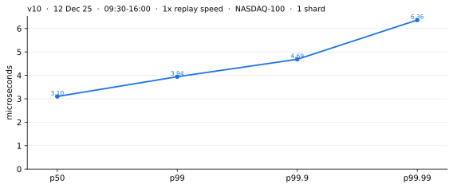

一整个交易时段, 09:30 到 16:00, 按当时发生的速度, 一点都没跳过: 收进 9.12 亿条消息, 发出 3,893,353 张订单, 订单数相当于 Nasdaq-100 里会改动订单簿的那些消息的 3.9%。

信号按每只股票分别算, 用的是订单簿上挂着的股数:

1) `r = (bid1 + bid2 + bid3) / (bid1 + bid2 + bid3 + ask1 + ask2 + ask3)`
2) `r` 超过 75%, 并且比这只股票上一次触发时更大: 买。低于 25%, 并且比上一次更小: 卖。其他情况, 什么都不做。
3) 每张单一股, immediate or cancel, 吃掉对手方的挂单。

网卡是 10 GbE 的, 一个口发、另一个口收, 所以 A、B 两路行情共用一条链路。这条链路就是包到达 CPU 的速度上限: 在最忙的那一段, 一路行情就让链路连续满载 857 μs, 两路一起是它的两倍。

## 时间花在哪儿 (baseline-v10-ilp-mlp-parse-and-book)

| | 是什么 | p50 ns | p90 ns | p99 ns | p99.9 ns | 最大值 ns |
| --- | --- | ---: | ---: | ---: | ---: | ---: |
| `wait` | 从包到达, 到我们收到通知 | 99 | 300 | 744 | 1,254 | 2,982 |
| `fetch` | 把包取上来 (发出预取, 但不等预取完成) | 40 | 40 | 50 | 70 | 250 |
| **`work` (3.31 GHz, 含 DRAM 读延迟)** | **`work 1` 到 `work 6` 的全部** | **620** | **890** | **1,360** | **1,930** | **3,050** |
| `work 1: parse` | 解析 ITCH 消息并分拣 | 180 | 320 | 470 | 730 | 1,960 |
| `work 2: book` | 分七遍把它们应用到订单簿上 | 160 | 280 | 530 | 810 | 1,540 |
| `work 3: signal` | 判断信号 | 90 | 120 | 380 | 790 | 1,720 |
| `work 4: fields` | 写订单里会变的那 5 个字段 | 40 | 50 | 100 | 340 | 750 |
| `work 5: header` | TCP 头和两个校验和 | 130 | 200 | 470 | 640 | 880 |
| `work 6: doorbell` | 敲门铃 (doorbell) | 20 | 30 | 50 | 140 | 410 |
| **`send`** | **从交给网卡, 到字节上线** | **2,453** | **2,570** | **2,869** | **7,246** | **18,998** |
| `total` | wire-to-wire, 全程 | 3,248 | 3,636 | 4,232 | 4,873 | 7,294 |

`wait` 和 `send` 是跨两个时钟计时的 (网卡的和 CPU 的), 所以量出来可能偏大 —— 这就是为什么在 p99.9 和最大值上 `send` 比 `total` 还大。

`fetch`、`work`、`work 1` 到 `work 6` 以及 `total`, 都是在同一个时钟上开始和结束的, 所以这些数是准确的。

## 每个版本换来了什么

一个分支一项技术, 和它前一个版本对比着量, 两个版本轮流跑。

[其中最精彩的一次优化是 v9](#v9做了什么)

对应低延迟笔记:

[在飞的 MLP = min(LFB, 窗口/L, 手上的活)](#mlp)

v2 做了什么 (没改代码):

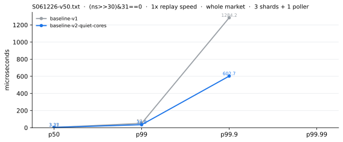

1) 把别的活挡在预留的核外面。原来有一个 ssh 隧道每九十秒在其中一个核上醒一次。
2) isolcpus 能阻止调度器把活搬到一个核上。但一个任务只要允许在这个核上跑, 照样能落到它上面, 而且落上去之后, 调度器再也不会把它搬走。
3) 跑测期间不再读 UEFI 变量 —— 读一次就会让两颗 CPU 冻住 1.13 ms。
4) 冻住之后, 重放会全速追赶, 于是一毫秒的数据一下子全到了。

v3 做了什么:

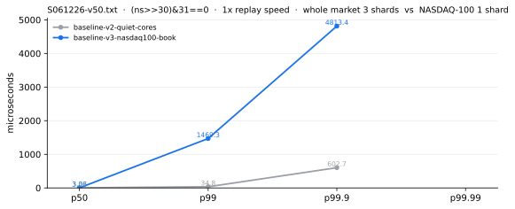

1) 只给 Nasdaq-100 建订单簿。整个行情还是全部进来, 因为 Nasdaq 只发一条流。
2) 一个核干完全部的活, 以前要一个轮询线程加三个分片。
3) 名单变短并没有让中位数变化。让中位数变的是去掉了核之间的交接, 降了 218-417 ns。
4) 短名单换来的, 是一个核终于能跟得上。
5) 这个版本的尾巴变差了, 因为三个分片变成了一个。

这里的延迟不要过度解读 —— 这张图里两个版本承担的负载已经不一样了。Nasdaq-100 大约占全市场消息的 11%, 现在由一个核扛这一部分, 而原来是三个核扛全部。

v4 做了什么:

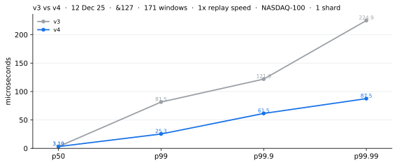

1) 现在几张订单共用一条消息, 在消息装满或者这次轮询结束时发出。
2) 发一次要 870 ns, 其中 810 ns 是每条消息付一次, 不是每张订单付一次。
3) 所以一次触发了八十张订单的轮询, 以前要付八十次这个代价。
4) 代价是中位数多了 90 ns: 第一张订单要等后面的订单。

v5 做了什么:

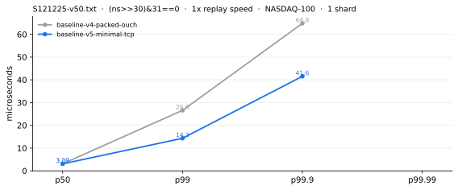

1) 发单路径现在走的是我自己的 TCP: 110 ns, 而走协议栈要 1,540 ns。
2) 这 1,540 ns 里有 1,090 ns 花在一次调用上, 而且这次调用是在敲过网卡门铃之后才跑的。
3) 所以它从来没拖慢过它自己那张订单, 只拖慢排在后面的订单 —— 它是尾部的代价, 不是中位数的代价。

v6 做了什么:

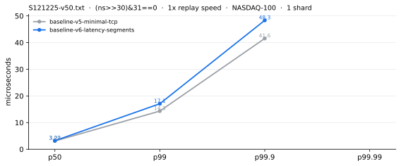

1) 在五个点打时间戳, 这样 wire-to-wire 就拆成了四段。
2) 这样才看出来, 我看到一个包之前的那段等待是我自己造成的 —— 我还在忙上一批, 没有去看有没有新包。
3) 加了一个开关, 能把订单簿和信号这两步关掉, 看看它们下面的地板是多少。
4) 这是一条记录, 不是一个结果: 这里变的不只是代码, 机器也变了。
5) 这里路径没有变。数稍微差一点, 只是因为我加了 rdtsc 和 lfence 来测量它。

v7 做了什么:

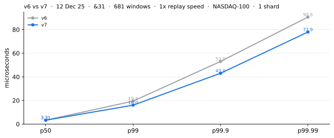

1) 交易所的回报有了自己的接收队列, 不再排在行情后面。
2) 也有了自己的线程 —— 一个线程管两个队列的话, 仍然会卡在同一批里。
3) 在收盘前十分钟全速跑, 被拒的订单从 9,485 张变成了 0。
4) 中位数没动: 在另一个核上读回报大约要 89 ns。

v8 做了什么:

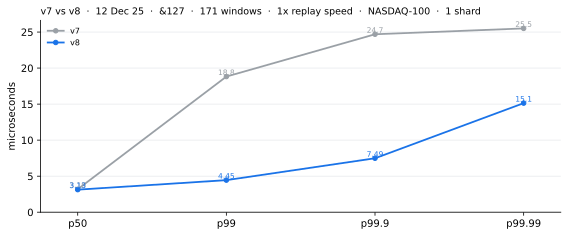

1) 信号每次轮询判一次, 而不是每条消息判一次。
2) 一次轮询可能带着同一只股票的几百条消息。
3) 而且只有当天平比上一次倾斜得更厉害时才触发。
4) 发出的订单数还是差不多, 从 4.79% 降到 4.49%, 所以这一版并没有少交易。

---

**从这里开始, 一轮是 09:30 到 10:10, 50 倍速。剩下要修的全在尾巴上, 而按真实速度跑, 造成尾巴的那些时刻几乎不怎么出现。把重放加快五十倍, 对代码的压力就大到能让它的弱点露出来, 这时新旧两个版本才分得出高下。**

<a id="v9"></a><a id="v9做了什么"></a>

**v9 做了什么: ⭐**

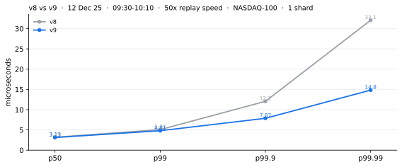

1. 到 v9 版本, 每只股票 (比如 AAPL) 的数据结构:

```
Level        每个价位一个 4B 的 sum_qty, 一共「价位数量」个:
             价位数量 = 昨日收盘价 / 8 到 昨日收盘价 × 8 之间的 tick 数
             重要: Level 不存储每个价位的订单有哪些, 因为 NASDAQ 给的是成交的订单,
             而不是给我一个需要和对手方成交的订单, 所以不需要我维护撮合引擎

PoolMap      唯一一个存储订单的结构, 类似于 unordered_map, 但是
               1) 启动时预先分配几 GB (也可以用几十GB甚至更多) 连续地址的 Node 数组,
                  用 huge page 并触页, 不需要考虑运行时不够的情况,
               2) 用 pool 加了 node 的后进先出, 因为刚回收的 node 很可能还在缓存里,
               3) 用 base (预先分配起始地址) + next 4B 计算下一个 node 的地址
             oid -> Node 24B: { uint64_t oid; uint32_t shares; uint32_t price;
                                uint32_t next; uint16_t sym; uint8_t side; }
             撤单或成交时, 用 oid 直接找到这笔单, 改它的 shares, 再改 Level 的 sum_qty

PriceBitmap  用于策略查询 bid 1 2 3 和 offer 1 2 3 的价位, 再通过 Level 得到 sum_qty,
             由 3 层 uint64_t 的 bitmap 组成, 第一层每一位代表这个价位有没有单子,
             第二层每一位代表第一层的某个 uint64_t 是不是 != 0:
               第一层内存 = 价位数量 / 64¹ × 8 B
               第二层内存 = 价位数量 / 64² × 8 B
               第三层内存 = 价位数量 / 64³ × 8 B
             用 bitmask 掩码, 再用 __builtin_clzll, 几个周期就能查出下一个有挂单的价位
             相比于 list: 连续查询时, 一个 uint64_t 就能查 64 个价位,
             而盘口价位更多是连续有订单, 所以性能优于 list
```

2. 我不再是处理完一个订单, 再去处理下一个订单, 而是把一批订单按类型分组, 然后把分组的订单用批处理进行处理。

先把这一批拿到的所有 packet 和每个 packet 的所有订单过一遍, 按类型分进 4 个数组 (存的是这条消息在这一批里是第几条):

```
uint32_t bucket_add[kMaxHits];    // A, F
uint32_t bucket_repl[kMaxHits];   // U
uint32_t bucket_del[kMaxHits];    // D
uint32_t bucket_cut[kMaxHits];    // E, C, X
```

```
A = Add
F = Add with MPID
U = Replace = U1 (Delete) + U2 (Add)
D = Delete
E = Executed
C = Executed with price
X = Cancel

遍 1  A/F    bucket_add 里的每个订单: 在 PoolMap 用 oid 建好新单
             (不管它在这一批里排第几, 前面有 U 或 X 也一样)
遍 2  U2     bucket_repl 里的每个订单: 用 new_oid (U2) 建好新单, 放入 PoolMap,
             订单的 side (这时还不知道) 先空着, 记下 new_oid 的 side 的地址
遍 3  U1     bucket_repl 里的每个订单: 用 hashmap 查 old_oid 对应的订单,
             记下它的 side 的地址, 什么都不改
遍 4  U2     bucket_repl 里的每个订单: 按顺序, 把旧单的 side 抄给新单
             (只有这一遍需要按顺序)
遍 5  U1     bucket_repl 里的每个订单: 用 old_oid (U1) 把旧单从 PoolMap 删掉
遍 6  D      bucket_del 里的每个订单: 用 oid 在 PoolMap 进行整笔撤单
遍 7  E/C/X  bucket_cut 里的每个订单: 减 qty; 查不到就跳过, 省下计算
             (查不到说明这笔单在这一批里最终会被 D 撤掉, 或者被 U 换掉)
```

遇到的困难: U 的问题是, U 不带 side, 新单的 side 需要从旧单查表获取。但是新单的 U2 (添加) 需要先跑, 而 U1 (删除) 还没跑, U1 (旧单) 的 side 还不知道, 所以 U2 (添加) 先跑的时候 side 是留空的。

```
这一批来之前, APPL 的订单簿:    { 0123: Node }    <- 0123 是以前那一批的订单, side=buy

这一批里的三条 U, U 不带 side:
U: APPL  old_oid 0123 -> new_oid 1234
U: APPL  old_oid 1234 -> new_oid 2345    <- 1234 是上一条 U 刚建的新单
U: APPL  old_oid 2345 -> new_oid 3456    <- 3456 是这一批最终存活的订单

这一批走完之后, APPL 的订单簿:  { 3456: Node }    <- side=buy, 从 0123 一路传下来
```

遇到的另一个困难: 类似于上面的示例, 同一批里的 U 常常连成一条链 (这条 U 的旧单, 正是前一条 U 刚建的新单), 所以如果先做 U1 (删除), 会导致发现订单号不存在。比如先执行第二条 U 的 U1 (删除 APPL old_oid 1234), 会发现 oid 1234 在 PoolMap 中还不存在 —— 它要等第一条 U 的 U2 (添加) 才会建出来。

所以只能先做 U2 (添加) 再做 U1 (删除), U2 把 side 留空, U1 查表完成后, 补上 U2 的 side, 再删除 U1

到这里, 订单簿就更新完了, 同按照 packet 顺序和每个 packet 中 order 的顺序, 挨个更新订单, 结果是一致的

3. Q: 采用这样的设计的目的是什么?

   A: 这样的设计使得我可以乱序执行交易所发来的订单更新(除了`遍4`之外, 每一遍的执行中, 每个订单之间都没有依赖关系), 从而批量并行处理同一种订单 (因为处理逻辑一致, 所以代码一致, 比如同时处理 16 个撤销订单), 把 A D A D A D 的订单流变成 A A A D D D 的订单流, 而代码逻辑一致并且订单之间互相独立, 使得我可以通过分圈, 启用 MLP 技术, 在 PoolMap 的查表中, 把 8 次 cacheline missing 的延迟压缩到 1 次 cacheline missing 的延迟, 从而大幅降低一个批次内 cacheline missing 的总延迟。[实测](#mlp-measured)

---

v10 做了什么: ⭐

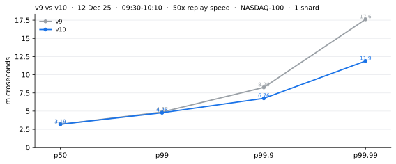

1) 到这一步, 除了解析之外已经没剩多少可以削掉的了, 所以这一轮用的还是我最喜欢的工具: instruction and memory level parallelism, 意思是让 CPU 同时等好几件互相独立的事, 而不是一件接一件地等。在以算术为主的活上, 它大约值 1.5 倍; 在不停 cache miss 的活上, 最多约 4 倍, 因为同时等四条缓存行的代价, 和只等一条差不多。

---

**经过前面十个版本的优化, 延迟已经足够低, 可以做最后一项测试了: 用这块网卡能发出的最快速度重放行情, 从头到尾每一刻都是爆发。blast 模式去掉了配速, 一个网卡口同时承载 A 路和 B 路行情, 8 到 8.3 Gb/s。实盘里每一路行情都有自己的链路, 而且真实行情只在短暂的爆发里才到线速; 这里一刻不停, 所以代码要扛住连续不断的 8 Gb/s 输入。这是我给它的最大压力。如果在这里尾延迟还能保持稳定, 我就认为尾延迟不再是问题。**

v11 做了什么:

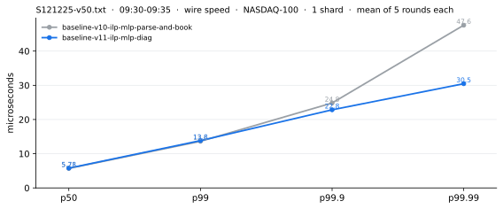

1) 我又用了一次 ILP 和 MLP, 这次是先诊断了代码再用的。
2) 它只让尾巴变好, p50 反而稍差一点。这里 p50 是 5.5 到 6 μs, 因为重放是按线路的满速跑的, 中间不停。

| 轮次 | p50 | p99 | p99.9 | p99.99 | 最大值 | >10 μs | >20 μs | >30 μs | >40 μs | >60 μs |
| --- | ---: | ---: | ---: | ---: | ---: | ---: | ---: | ---: | ---: | ---: |
| A1 | 5,587 | 13,627 | 24,424 | 34,255 | 69,573 | 2,500 | 144 | 14 | 1 | 1 |
| A2 | 5,796 | 13,511 | 23,490 | 42,114 | 81,487 | 2,484 | 106 | 20 | 7 | 2 |
| A3 | 5,737 | 13,921 | 24,492 | 48,132 | 57,787 | 2,575 | 146 | 14 | 8 | 0 |
| A4 | 5,678 | 13,059 | 22,443 | 45,203 | 82,113 | 2,233 | 85 | 24 | 9 | 1 |
| A5 | 5,736 | 14,022 | 29,282 | 68,164 | 88,208 | 2,530 | 163 | 56 | 28 | 7 |
| **A, 5 轮平均** | **5,707** | **13,628** | **24,826** | **47,574** | **75,834** | **2,464** | **128.8** | **25.6** | **10.6** | **2.2** |
| B1 | 5,648 | 13,114 | 22,572 | 30,939 | 39,905 | 2,290 | 89 | 7 | 0 | 0 |
| B2 | 5,647 | 13,510 | 21,720 | 31,742 | 40,412 | 2,422 | 89 | 7 | 2 | 0 |
| B3 | 5,826 | 13,389 | 21,706 | 28,081 | 56,110 | 2,396 | 91 | 5 | 1 | 0 |
| B4 | 5,916 | 15,342 | 24,973 | 33,117 | 44,316 | 2,825 | 203 | 11 | 3 | 0 |
| B5 | 5,856 | 13,811 | 23,215 | 28,460 | 38,468 | 2,481 | 119 | 3 | 0 | 0 |
| **B, 5 轮平均** | **5,779** | **13,833** | **22,837** | **30,468** | **43,842** | **2,483** | **118.2** | **6.6** | **1.2** | **0.0** |
| **B 对比 A** | **+1.3%** | **+1.5%** | **-8.0%** | **-36.0%** | **-42.2%** | **+0.7%** | **-8.2%** | **-74.2%** | **-88.7%** | **-100%** |

`>10 μs` 是耗时超过 10 μs 的订单数。

---

# 低延迟工程笔记

---

## 目录

**1. 核的内部**

- [ROB: 乱序执行, 按序退休](#rob)
- [超过约 22 个 load 时队列会堵住, 不会丢](#prefetch)
- [在飞的 MLP = min(LFB, 窗口/L, 手上的活)](#mlp) ⭐
- [if 和 ?: 生成的汇编一样; cmov 不是免费的](#cmov)
- [每周期一个 store, 32 B 宽, 而且不是原子的](#store)

**2. 多核: 真正的锁是缓存行**

- [每次写共享数据都要 RFO: 10–300 ns](#rfo) ⭐
- [CAS 重试按 n(n+1)/2 增长: 改成了单写者](#cas)
- [lock-free vs wait-free](#lockfree) ⭐
- [double 上的 fetch_add 不是 wait-free](#atomic-trap)
- [CAS 的 spurious failure 来自 LL/SC, 不是来自 x86](#weak)
- [store buffer 让 SPSC 往 shm 写快照几乎免费](#storebuf) ⭐
- [Intel 上的伪共享: alignas(128), 而不是 alignas(64)](#false-sharing)

**3. 内存序**

- [acquire/release 在 x86 上免费; seq_cst store 要 20–30 个周期](#mo-cost)
- [seq_cst 换来一个所有线程都认同的顺序](#seqcst)
- [CAS 成功 / 失败时的内存序](#cas-mo)

**4. 页表、内核、缓存**

- [段错误: 那个虚拟地址没有映射](#segv)
- [new 之后第一次写时的软缺页](#pf)
- [陷入内核: ROB 被清空, 缓存/TLB 变冷](#trap)
- [free() 超过 128 KB: TLB shootdown IPI](#ipi) ⭐
- [步长 4096 B 时 L1D 只放得下 8 行](#l1d)

**5. 热路径上的 C++**

- [一次 std::string 分配要走 5 层, 最多 1–2 μs](#string)
- [跨线程 free 会让生产者的 tcache 空掉](#tcache)
- [热路径上 throw 要 5–50 μs; 我用 std::expected](#throw)
- [NRVO 直接在调用方构造返回值](#nrvo)
- [vector 扩容时移动还是拷贝, 取决于 noexcept](#noexcept)
- [lazy binding 让第一次调用多出 ~3 μs](#binding) ⭐
- [unordered_map: 先是桶数组, 再是节点链](#umap)
- [unordered_map 每个节点都要 malloc, 开放寻址不用](#hashmap)
- [对包缓冲区做 reinterpret_cast 是 UB](#slt)
- [切字段时 views::split 比 find 和 substr 快](#split)
- [用 std::byteswap 处理大端的线上格式](#byteswap)

**6. 测量和验证**

- [rdtsc 要配 lfence; rdtscp 会返回核号](#rdtsc)
- [用 objdump 检查优化有没有发生](#objdump)

**7. 解析**

- [MoldUDP64 + ITCH: 偏移固定, 原地切分](#itch)

**8. Solarflare / kernel bypass**

- [CTPIO 直通 (cut-through)](#sfc)
- [自旋的核越多, 网卡的写落地越晚](#dma)
- [放弃 Onload: Onload 每次调用要 1,090 ns, 在 p99.9 上多花 23 μs](#mintcp) ⭐
- [网卡发热: 接近极限时网卡会降频](#heat)
- [FPGA vs CPU: tick 到来之前, 订单已经在 FPGA 里了](#fpga)

---

## 1. 核的内部

<a id="rob"></a>

### ROB: 乱序执行, 按序退休

CPU 里有一个叫 ROB 的指令窗口缓冲区。ROB 里的 micro-op 只要依赖都准备好了, CPU 的调度器就可以执行它。CPU 还有大约 16 个执行端口 —— 加法、乘法、load、store 等等。每个端口每个时钟周期只能接收一条指令, 但并不是所有指令都能在一个周期内做完。每个执行端口都有一条流水线, 中间值每个时钟周期保存一次, 下一个周期再沿着流水线往前走。比如加法要一个周期, 乘法要 3 个。

ROB 的大小在 AMD/Intel 之间、在不同的架构之间都不一样。ROB: Zen 5 448 / Skylake 224 / Golden Cove 512。

ROB 带来了乱序执行, 但指令仍然按顺序退休 (retire)。按序退休保证语义正确, 乱序执行让 CPU 跑得快 —— 它让 load 这样的操作一进 ROB 就能发出去。这也是为什么在大多数情况下, prefetch 在现代 CPU 上只能帮上一点点忙。

乱序执行和执行端口, 就是现代 CPU 每个时钟周期能退休 3–4 条指令的原因。这就是 perf 里的 IPC。在同一个时钟周期里, 把 ROB 里的指令并行地送到各个执行端口, 这就是 ILP, 它让代码跑得更快。

但像 exp/log 这种函数, 展开之后是很长的串行依赖链, 很难从中得到 ILP。`unordered_map` 和 `map` 上的 `find` 也一样 —— 它们也很难用 ILP/MLP 并行起来。

<a id="prefetch"></a>

### 超过约 22 个 load 时队列会堵住, 不会丢

当 CPU 有超过约 22 个还没完成的 load 时, 它是丢掉一个, 还是停住?

有两件事要分开看: prefetch 不等它的数据, 但它确实要占一个位置。

```
prefetch 发出        占一个 load queue 位置, 再申请一个位置来跟踪那条缓存行
有空闲的跟踪位置     交给它, prefetch 不等数据就退休了   <- 正常情况
跟踪位置满了         它退休不了, 于是待在 load queue 里等
```

所以发生的不是丢弃, 而是背压。load queue 一满, 前端就一条指令都塞不进去了, 所以停住的不只是访存 —— 而是整条流水线。

<a id="mlp"></a>

### 在飞的 MLP = min(LFB, 窗口/L, 手上的活)

这是我自己的经验; 我没找到多少写下来的相关指导。不过, 这个方法是低延迟系统里最有效的方法之一。

```
M = min( LFB , W / L , 手上互相独立的 miss 数 )
每个 miss 的代价 = miss 延迟 / M
```

`M` 是在飞的 MLP 数, 我想让它更大。一旦它达到 `LFB`, 就再没有往上加的余地了。

比如在 hashmap 里做 8 次互相独立的查找 (8 个不同的订单号), 每次查找 miss 一次:

```
第 1 次   L3 也 miss, 去 DRAM   110 ns
第 2 次   L3 也 miss, 去 DRAM   120 ns
第 3 次   L2 miss, L3 命中       12 ns   (39 个周期, 3.31 GHz 下)
第 4 次   L3 也 miss, 去 DRAM   125 ns
第 5 次   L3 也 miss, 去 DRAM   130 ns
第 6 次   L3 也 miss, 去 DRAM   115 ns
第 7 次   L2 miss, L3 命中       12 ns
第 8 次   L3 也 miss, 去 DRAM   120 ns

不用 MLP   一个接一个   110 + 120 + 12 + 125 + 130 + 115 + 12 + 120 = 744 ns
用 MLP     8 个一起发   ≈ max(110, 120, 12, 125, 130, 115, 12, 120) = 130 ns
```

能做到 130 ns 有两个前提: 这 8 次查找互相不依赖 (后一次的地址不用等前一次的结果), 而且 M 装得下 8 个 (8 小于 Zen 2 的 22 个 MSHR, 循环也短到能让 8 次查找同时待在乱序窗口里)。

<a id="mlp-measured"></a>⭐⭐⭐这台机器上实测: 8 次互相独立、每次都去 DRAM 的访存, 一个接一个要约 1,002 ns (每次约 125 ns), 一起发约 136 ns。⭐⭐⭐

```
LFB   跟踪 miss 的位置。任何一次 L1 miss 都要占一个, 而一次 DRAM 读占住它的时间
      是 L3 命中的十倍, 所以把它们用光的是 DRAM。

W     乱序窗口, 按指令条数算, 大约 120-240。
      它不是每个 CPU 一个固定的数: 下面这几样里谁先用光, 就由谁决定,
      所以它也取决于这个循环是由什么组成的。
        ROB   每条还没退休的指令占一个位置
        PRF   写寄存器的指令再多占一个
        LDQ   读内存的指令再多占一个
        STQ   写内存的指令再多占一个 (也就是 store buffer)

L     循环体里的指令条数 / 其中真正 cache miss 的有几条
```

AMD / Intel 最新架构的量级, 以及本项目这台机器的 Zen 2:

| | AMD Zen 2 (本项目) | AMD Zen 5 | Intel Lion Cove |
| --- | ---: | ---: | ---: |
| ROB | 224 | 448 | 576 |
| 整数 PRF | 180 | 240 | 未公布, 实测约 290 |
| load queue | 44 | 未公布, 实测约 202 | 未公布, 实测约 189 |
| store queue | 48 | 104 | 实测 120 |
| MSHR (Intel 叫做 LFB, AMD 叫做 MAB) | 22 | 124 | 24, 外加 80 个 L2 miss 队列 |

这些是硬件结构的大小, 不是一个循环实际能达到的数。标「实测」的几格厂商没有公布, 数字来自 Chips and Cheese 的微基准。

<a id="cmov"></a>

### if 和 ?: 生成的汇编一样; cmov 不是免费的

1. 语法不决定用哪条指令。`if` 和 `?:` 在编译器前端会被降成同样的 IR, 所以最后得到的是 `jne` 还是 `cmovne`, 和我写的是哪一种无关。`if (b) a=1; else a=0;` 和 `a = b?1:0;` 在 -O2 下生成完全相同的汇编 (这个例子里两者都不是, 只是一条 `movzx`)。
2. 决定用不用 cmov 的, 是两边是不是都能安全地求值。cmov 会把两条路径都算出来再挑一个, 所以在下面这些情况下, 编译器只能生成跳转:

```cpp
int a = p ? *p : 0;                      // 可能解引用空指针
int b = c ? cheap() : has_side_effect();  // 有副作用
```

这个限制对 `if` 和 `?:` 是一样的。

3. cmov 通常并不更快。一个预测正确的分支, 在关键路径上的代价是 0 个周期。
4. 我想要无分支的代码时, 不会靠语法去暗示。我用算术掩码 `(-(int)c & (x^y)) ^ y`、`std::min`/`std::max`, 或者查表, 然后用 godbolt / objdump 确认。
5. 取指和预测是自己单独的一段流水线, 跑在执行单元前面几十条指令。预测器查 BTB, 和后端在算别的东西, 是在同一时刻发生的。比较本身的代价大约是吞吐每周期 2 条、延迟 1 个周期, 而且因为有推测执行, 没有人在等它。

<a id="store"></a>

### 每周期一个 store, 32 B 宽, 而且不是原子的

```
Zen 2, 每个周期         2 个 load 和 1 个 store
单个 store 最宽         32 B (Zen 2 把数据通路从 16 加宽到了 32;
                        Zen 1 还得把它拆成两个 μop)
```

一个 store 只占 store 端口。load 走 load 端口, 地址计算和查表走 ALU 端口, 这些全都可以在同一个周期里进行。

store 之前, 必须先把那条缓存行的旧内容取回来。写整条缓存行理论上可以跳过这一步, 但能确定跳过的只有 non-temporal store 和 `MOVDIR64B`。

x86 只保证 8 B 自然对齐的访问是一次完成、不会被拆开的。对 16 / 32 / 64 B 的访问, 手册明确说它们可能被拆成好几次访问来完成 —— 所以一个 32 B 的 store 不是原子的。

实际上在 Zen 2 上, 我抓不到它被拆开的时候: 它是一个 μop, 整块在一个周期里进 L1, 另一个核只能通过 probe 把这条缓存行整条拿过去。但那是这一代的实现, 不是保证。

---

## 2. 多核: 真正的锁是缓存行

<a id="rfo"></a>

### 每次写共享数据都要 RFO: 10–300 ns

不管是 `int` 还是 `atomic<int>`, 改它都意味着要向目录 (directory) 发一个 RFO (request for ownership, 请求所有权)。目录会通知每一个持有这条 64 B 缓存行的核把它作废。等所有的 ACK 都回来了, 这条缓存行在我的核里变成 M 状态, 写才发生。

这需要时间。所以在我写的时候, 另一个核的这条 64 B 缓存行刚被作废, 而它又想读, 它就会把请求发给目录。目录把这个请求排在 RFO 后面。读要等写落地之后才能进行, 读到的是新值。这个 load 被堵住了 —— 但因为有 ROB, 它后面的指令仍然可以乱序执行。

**MOESI**: Modified、Owned、Exclusive、Shared、Invalid。如果我处在 M 状态, 另一个核想读, 我可以降到 O, 并给它 S。这两份 (O 和 S) 都和内存里的不一样, 所以都算脏的。所以 Owned 可以是这个样子: 一个核持有 8 (主副本), RAM 里是 7, 其他核持有 8 (副本)。它和 M 的区别是, M 不允许别人持有副本。相同的地方是, M 和 O 一样, 都可以和 RAM 不一致。写回内存完全是 Owned 持有者的事 —— Shared 持有者从不写回 —— 而且是在 Owned 持有者被逐出的时候发生。

`int` 和 `atomic<int>` 都需要 RFO。区别在于 atomic 把 load、计算和 store 绑在一起, 中间不会有别人插进来 load。所以只有几个核同时写的时候才需要 atomic。一个写者加多个读者不需要。

**延迟 (最重要的部分: 核到核的延迟 = RFO 延迟)。**

1. 如果这条缓存行已经在我的 L1 里, 并且是 E 或 M 状态, 我可以不发 RFO, 直接写。这两个状态都表示这是唯一的一份, 所以省掉了让目录去作废其他核的代价。
   - 1.1 不需要 RFO 时, 在 x86 上这个修改是一条汇编指令 `lock add [mem]`: 5–10 ns (约 15–30 个周期, 一条指令, 9–10 个 uop, 原子的 —— 大部分时间花在 `lock` 上)。非常快, 因为不需要通知目录。但还是比 `int++` 慢, 后者是一条 `inc [mem]`, 约 2 ns (约 6 个周期的 load-加一-store, 几个 uop, 不是原子的)。
   - 1.2 不需要 RFO 时, 在 ARM 上它是一个由几条汇编指令组成的 LL/SC 重试循环。ARMv8.1-A 及以后的版本也有一条类似 x86 `lock add [mem]` 的单条指令。
   - 1.3 `inc [mem]`, 非原子: 4 个 uop (load / ALU / store-address / store-data), 6 个周期。
   - 1.4 `lock add [mem]`, 原子: 需要 (a) lock, 它把缓存行钉在 M/E 状态, 再加上 (b) 内存屏障的微码。9–10 个 uop, 18–22 个周期。
2. 如果这条缓存行在我的 L1 里, 但不是 E 或 M 状态, 我就得取得它的所有权。升级到 M 的这一步就是 RFO 延迟, 代价就出在这里。

| | RFO 延迟 (核到核) | 发生了什么 |
| --- | --- | --- |
| 同一个物理核 | 10 ns (这里不可能出现非 E/M 状态) | 只有一份, 所以可以直接写; 但汇编是 `lock cmpxchg`, 所以仍然要约 30 个周期 |
| 不同物理核, 同一个 CCX | 25–35 ns | 借助 L3 的 shadow tag 作废 |
| 不同 CCX, 同一个 socket | 95–110 ns | 整个 socket 范围的 RFO 作废 |
| 不同 socket | 200–260 ns | 跨 socket 的 RFO 作废 |

(前三行假设目录在同一个 socket 上。如果另一个核想从刚写完的那个核那里把数据拉过去, 这个延迟在四种情况下都和 RFO 延迟差不多。)

在 AMD 7K62 上实测:

| 情况 | CPU 对 | load p50 | RFO p50 |
| --- | --- | ---: | ---: |
| 本地, 无竞争的 CAS | cpu24 | — | ~10 ns |
| 同一个物理核, SMT | 24 / 120 | ~10 ns | ~10 ns |
| 不同物理核, 同一个 CCX/L3 | 24 / 25 | ~30–40 ns | ~40 ns |
| 不同 CCX, 同一个 socket | 24 / 28, 24 / 40 | ~130–150 ns | ~150–180 ns |
| 不同 socket | 24 / 48, 24 / 72 | ~270 ns | ~300 ns |

Intel Xeon Scalable 的典型估计值:

| 情况 | load p50 | RFO/CAS p50 |
| --- | ---: | ---: |
| 本地核 | 5–10 ns | 8–15 ns |
| 同一个物理核, SMT | 8–15 ns | 10–20 ns |
| 同一个 socket, 近处的核 | 25–40 ns | 35–55 ns |
| 同一个 socket, 远处的核 | 40–70 ns | 55–100 ns |
| 跨 SNC 簇 | 60–110 ns | 80–150 ns |
| 跨 socket / UPI | 130–250 ns | 170–300 ns |

`load p50` 测的是读一条共享的缓存行。`RFO/CAS p50` 测的是为了能写而取得独占所有权 —— 也就是 CAS 的 cache-line bouncing。

3. 如果这条缓存行根本不在我的 L1 里, 我既要作废其他核的副本, *又*要把这 64 B 取回来。这比情况 2 慢。回来的数据放在一个 LFB/MSHR 里, 这 64 B 和所有权一起, 经由 Owned 持有者或者 L3 回来。

还有一点: 我在 socket 0 上, 不知道 socket 1 有没有副本。我必须查一下, 否则 socket 1 可能一直在用过期的数据。但我不是去问 socket 1 —— 我是去查 home 节点的目录。如果 home 在我这个 socket 上, 会快很多。如果 home 在另一个 socket 上就慢, 和发往远端 socket 的 RFO 一样慢。

<a id="cas"></a>

### CAS 重试按 n(n+1)/2 增长: 改成了单写者

atomic 仍然解决不了 cacheline bouncing, 而且还在上面多加了第二个问题: cacheline contention。假设有 `atomic<double> risk_budget = 100.0` 和两个线程 A、B。A load 了它, B 也 load 了它。在一个线程一张订单的设计里, 这种情况很多 —— 同一时刻、同一个订单簿, 所以两个都被触发去 load。然后 A 做一次 CAS store, B 也做一次 CAS store。A 做完了, B 发现值变了, B 只好重新 load、重新 store。这就是 cacheline contention。`fetch_add` 也躲不掉: 它的 load 和 store 不是一步完成的, 所以也是先 load 再 store, 也会争用。

除此之外, 每次要 load 的缓存行如果不在我自己的缓存里, 都要花 40–120 个周期从另一个线程那里拿过来, 这会加重尾延迟。

最坏情况是下面这样。P99.9 也差不多, 平均值要好不少。延迟大致随订单数的平方增长。

```
2 张订单:
A B load。成功, 缓存行: shared                                   100 cyc
A 计算                                                              x cyc
B 计算                                                              x cyc
A load 和 store。成功, 缓存行: A 为 Modified, B 为 invalid        100 cyc
B load 和 store。失败, 缓存行: B 为 Modified, A 为 invalid        100 cyc
B 计算                                                              x cyc
B load 和 store。成功, B 为 Modified, A 为 invalid, 在 L1 里    10–30 cyc
                                                    合计: 3x + 330 cyc

3 张订单:
A B C load。成功, 缓存行: shared                                 100 cyc
A / B / C 计算                                                     3x cyc
A load 和 store。成功, A 为 Modified, B C 为 invalid             100 cyc
B load 和 store。失败, B 为 Modified, A C 为 invalid             100 cyc
C load 和 store。失败, C 为 Modified, A B 为 invalid             100 cyc
B 计算 / C 计算                                                    2x cyc
B load 和 store。成功, B 为 Modified, A C 为 invalid             100 cyc
C load 和 store。失败, C 为 Modified, A B 为 invalid             100 cyc
C 计算                                                              x cyc
C load 和 store。成功, C 为 Modified, A B 为 invalid           10–30 cyc
                                                    合计: 6x + 634 cyc

4 张订单:
A: 1 次 load + 1 次尝试 + 1 次计算, 第 1 次成功
B: 1 次 load + 2 次尝试 + 2 次计算, 第 2 次成功
C: 1 次 load + 3 次尝试 + 3 次计算, 第 3 次成功
D: 1 次 load + 4 次尝试 + 4 次计算, 第 4 次成功
                                                   合计: 10x + 1034 cyc

5 张订单:                                          合计: 15x + 1530 cyc

总尝试次数 = n(1+n)/2, n = 下单线程数
```

绑到单个核上可以避免 cacheline bouncing, 但还是比不过单线程上的状态机。

策略决策大约 200 ns, 但 P99 >2000 ns, 因为我们一直在用 lock-free 的 CAS。很多订单同时在处理, 造成了 cacheline bouncing, 而且 `compare_exchange_weak` 编译出来是 `lock cmpxchg [memory], rdx`。为了解决这两个问题, 我们改成了单线程的 lock-free 设计。之后 P99 降了很多, 不过仍然明显, 因为同一时刻要处理很多订单, 本身就有一笔去不掉的代价。

```cpp
std::atomic<double> risk_budget{100.0};

double expected = risk_budget.load(std::memory_order_relaxed);
double desired;
do {
    desired = expected - order_risk;
} while (!risk_budget.compare_exchange_weak(
    expected, desired,
    std::memory_order_acq_rel, std::memory_order_relaxed));
```

<a id="lockfree"></a>

### lock-free vs wait-free

| | 范围 | 保证 |
| --- | --- | --- |
| lock-free | 整个系统 | 任何时刻, 至少有一个线程在往前推进 |
| wait-free | 每个线程 | 每个线程都在 k 步之内完成, 而且 k 不取决于其他线程 |

所以在一个有 1000 个线程的系统里, lock-free 的意思是每次至少有一个线程往前推进。对另外 999 个什么都不保证, 而这 999 个仍然可能在花算力试图往前推进。典型例子是 CAS。wait-free 的意思是每次全部 1000 个线程都往前推进, 所以不会有算力花在「另外 999 个也许能推进」的*机会*上。典型例子是 `fetch_add()`。

先不算并行带来的收益: **单线程单写者 > wait-free > lock-free > mutex**。

为什么用 atomic 而不用 mutex: atomic 更快, 没有竞争时常常只要 5–10 ns。而且 mutex 可能惹出大麻烦。一个线程拿到锁, 跑了一阵子, 操作系统让它去睡了。这时它后面的每个线程都得等它醒过来、做完、释放锁。与此同时, 任何其他去拿这把锁的线程, 都会先自旋一小会儿, 然后进内核去睡。

用 CAS 实现的 lock-free 主要解决两个问题:

1. A 持有锁。B 想拿, 自旋一小会儿, 拿不到就只能去睡 —— 而一旦睡了, 就是几 μs。
2. A 持有锁。A 跑了一阵子, 内核让 A 去睡了, 然后 B、C 和其他所有线程被调度上来, 但谁都拿不到锁。最后 A 醒过来把锁释放, 其他线程才能动。这是几十到几百 μs。除非锁里面的活很重, 否则这种情况很少见。

<a id="atomic-trap"></a>

### double 上的 fetch_add 不是 wait-free

`atomic<>::fetch_add()` 是 wait-free 的, 它的最坏情况和最好情况都是 O(n)。lock-free 包含 wait-free。CAS 是 lock-free 但不是 wait-free, CAS 的最坏情况是 O(n(n+1)/2)。

两个陷阱:

1. C++20 允许 `atomic<double>::fetch_add()`, 但并没有一条能把 double 相加的单条 RMW 指令。所以它变成了 load → 计算 → CAS, wait-free 就没了。真正支持的是 `sizeof(T) ≤ 8` 的整数和指针。
2. atomic 内部可能会加锁, 变成一个 mutex。`is_always_lock_free` 能检测出这种情况。

怎样防止 atomic 变成 mutex: 只要 `cmpxchg16b` 或 `cmpxchgq` 支持这个类型, 它至少不会变成 mutex。如果 `fetch_add` 指令支持它, 它就可以是 wait-free 的。注意, `cmpxchg16b` 能让 16 字节的类型做到 lock-free, 但 x86 根本没有 128 位的 `xadd`, 所以 16 字节的 `fetch_add` 永远做不到 wait-free。

相关的问题: 当一个 8 B 的 `long`/`double` 放不进 atomic 时, 一般是不是就得用 mutex? 不一定。问题不是「它能不能放进 `std::atomic`」, 而是「硬件的原子指令能不能做到」。如果做不到 lock-free, 标准库内部可能会用锁, 或者你可能得自己用 mutex。16 B 的 atomic 在一些 CPU 上可以通过 `cmpxchg16b` 实现, 但这没有保证。

<a id="weak"></a>

### CAS 的 spurious failure 来自 LL/SC, 不是来自 x86

`compare_exchange_weak` 可能会出现 spurious failure。但在 x86 上一条指令就完成了全部工作, 所以 weak 和 strong 的结果完全一样。即便如此, 你仍然不应该把 `if (lock.compare_exchange_strong())` 改成 weak, 尽管结果一样。在 `while (lock.compare_exchange_weak())` 里面应该用 weak, 因为失败了也只是多转几圈。

spurious failure 为什么会发生: 在 x86 上编译成汇编时, 它是一条指令 `lock cmpxchg`。在它不是单条 x86 指令的地方, 汇编就得用 LL/SC (Load-Linked / Store-Conditional)。这时, 如果另一个线程写了锁所在的那条 64 B 缓存行, 或者发生了上下文切换, 都算失败。这可能是 spurious failure, 也可能是真的失败。(在 x86 上, 另一个核*读*它没有关系, 因为 CAS 是一条指令。在 AMD 上, 另一个核读它可能有关系。) 所以这里把锁填充到 64 B 更好。

```cpp
std::atomic<bool> lock{false};
bool expected = false;
while (!lock.compare_exchange_weak(expected, true,   // ← weak
                                   std::memory_order_acquire,
                                   std::memory_order_relaxed)) {
    expected = false;
}
```

```cpp
std::atomic<int> lock{0};

int expected = 0;
while (!lock.compare_exchange_weak(
    expected,
    1,
    std::memory_order_acquire,
    std::memory_order_relaxed
)) {
    expected = 0;
}
```

<a id="storebuf"></a>

### store buffer 让 SPSC 往 shm 写快照几乎免费

场景: 实盘把收到的每条消息, 加上一份持仓快照, 通过一个 SPSC 队列送进共享内存, 再交给一个消费者, 好让另一个进程能读到。这对实盘没有实质影响 —— 除非我写得太多, 把 store buffer 写满了 (Zen 5 有 104 个条目)。那时后面的 store 指令就进不了 store buffer, store 指令也就没法从 ROB 退休。

为什么它能一直免费:

- SPSC 的生产者只写 `buf_`, 从不读它。
- 写那个 `atomic<int>` 也不需要读, 因为写之前的值已经在本地栈上了。我在这里故意不用 `fetch_add`: 写是免费的, 读是贵的。`fetch_add` 里有一次读, 而这次读要等 cacheline bouncing 结束才能继续。这会堵住 ROB, 让它后面的指令没法退休。
- 写用的是 release 序。只要是 x86 而不是 ARM, store buffer 本来就是 FIFO 的, 所以 release 没有额外的事要做。
- 唯一的读发生在写之前。即使是一次 64 B 按缓存行对齐的写, CPU 也不保证不会去读那条缓存行。幸运的是, 等那次读发生的时候, 指令已经退休了, store 待在 CPU 的 store buffer 里, 所以 ROB 根本看不到它。

> **问:** 我 store 的时候, 我的持仓数据会不会需要被复制一份? store buffer 不会马上发出去, 那我的 portfolio 是不是需要一份缓存行的拷贝, 从而增加延迟?
>
> **答:** 不会。store buffer 存的是*值*, 不是指针 —— STD uop 执行的那一刻, 这些字节就被复制进了 store buffer 的条目里。portfolio 之后再怎么变, 都和这次 store 无关。硬件不需要额外复制任何东西。

相关的一点: 如果另一个核的工作依赖这次 store buffer 的写 —— SPSC 正是这种情况 —— 一个 `prefetchw` (带写意图的预取) 可以更早地发出 LFB/MSHR 请求, 让 store buffer 更早完成。

<a id="false-sharing"></a>

### Intel 上的伪共享: alignas(128), 而不是 alignas(64)

在 Intel 上, 当一个核在一条 64 B 缓存行上 miss 时, L2 的相邻行预取器 (adjacent-line prefetcher) 会把同一个对齐的 128 B 块里的另一条 64 B 缓存行也拉进来。它只是读那条缓存行。但如果另一个核正在写它, 那个核的副本就会变成 shared, 它下一次写就需要一次 RFO, 去作废被预取进来的那份副本。`alignas(128)` 让两个热字段不落在同一个块里。

---

## 3. 内存序

<a id="mo-cost"></a>

### acquire/release 在 x86 上免费; seq_cst store 要 20–30 个周期

| memory_order | 用在哪里 |
| --- | --- |
| relaxed | 没有顺序约束; 编译器可以随意重排。在 x86 上, 对不同的变量 (不同的地址), 只允许 store→load 重排; 其他三种都不允许 |
| acquire | 读 —— `load()` |
| release | 写 —— `store()` |
| acq_rel | RMW: `fetch_add`、`exchange`、`compare_exchange_weak/strong` —— 读的时候是 acquire, 写的时候是 release |
| seq_cst | 读和写都能用, 但它是强顺序, 会损失性能 |

记法: 读 → 写, acquire → release。

**acquire。** relaxed 读的问题: 值太早进了寄存器, RFO 的作废消息到了, 但还没被处理。解决办法是 acquire。用了 acquire, 后面的读仍然可以乱序执行, 读到的值也仍然可以拿去参与计算, 但在退休之前, 核会检查有没有发生过作废。如果有, 就重新读、重新算。它解决不了的: 它没法让另一个物理核发出 RFO。

硬件: x86 = `mov`, 免费。acquire 保证后面的读不会跑到它前面去, 而 x86 对不同的变量 (不同的地址) 只允许 store→load 重排 —— 其他三种, load→store、load→load、store→store, 都不允许。然后, 如果一条已经执行、但还没退休的指令发现它 load 的变量被作废了, 它就得重新 load、重新计算。这就是推测执行。ARM = `ldar`, 有代价。

**release。** relaxed 写的问题: 有 store buffer, 所以写完之后不会马上发 RFO。解决办法是 release。release 让你的这次写发生在你自己之前的修改 (比如对缓冲区的写) 都发出去之后。它解决不了的: 它没法作废其他物理核上的寄存器。

硬件: x86 = `mov`, 免费。store 用的指令和普通赋值一样, 因为 x86 的 store buffer 本来就是 FIFO 的。所以 release 只是在乱序执行时, 不让编译器把前面的操作挪到 store+release 那一行下面去。ARM = `stlr`, 有代价。

延迟 (x86, 不是 ARM):

Load:

| memory_order | 汇编 | 延迟 | 备注 |
| --- | --- | --- | --- |
| relaxed | `mov` | ~4 个周期 | 普通的 L1 load-to-use |
| acquire | `mov` | ~4 个周期 | 逐字节完全相同 |
| seq_cst | `mov` | ~4 个周期 | 逐字节完全相同 |

Store:

| memory_order | 汇编 | 延迟 | 备注 |
| --- | --- | --- | --- |
| relaxed | `mov` | ~0 个周期 | 一进 store buffer 就退休, 之后再排出 |
| release | `mov` | ~0 个周期 | 逐字节完全相同 (store buffer 本来就是 FIFO) |
| seq_cst | `xchg [mem], reg` | ~20–30 个周期 | 隐含 lock, 必须排空 store buffer |

**注 1。** store + release 的时间代价可以忽略 —— 意思是它不会堵住后面的代码, 不是说 RFO 的代价为零。我 store 的时候, store 进了 CPU 的 store buffer, 指令就退休了, 哪怕我现在并不拥有这条缓存行。唯一要紧的是, 后面没有东西去排空 store buffer, 比如一个 seq_cst 操作。

**注 2。** 写 16 B 时, 我的写指令进了 store buffer 然后退休, 不会堵住后面的指令。但缓存行是 64 B, 所以 `mov` 从 ROB 退休之后, 另外 48 B 仍然要读进来。这次读放在一个 LFB/MSHR 里。它不会堵住后面来的 uop, 因为 `mov` 已经退休了, 而在这里 store buffer 和 ROB 是各自独立工作的。完整写满 64 B 能不能避开 LFB/MSHR, CPU 并不保证。

<a id="seqcst"></a>

### seq_cst 换来一个所有线程都认同的顺序

1. 和 release 比: release 保证你之前缓冲着的写都发出去了, 你的这次写才会发生。seq_cst 还保证它后面的 load 不会跑到它自己这次写的前面。
2. 和 release/acquire 比: seq_cst 要求一个全局顺序。如果 T1 store `x = 1`, T2 store `y = 2`, 所有其他核对 x 和 y 谁先写的看法是一致的。release/acquire 只给使用 x 的那两个配对线程排顺序; 对其他线程什么都不保证。

```
T1        T2        T3              T4
x = 1;    y = 1;    r1=x; r2=y;     r3=y; r4=x;
```

`r1=1, r2=0, r3=1, r4=0` 可能出现吗?

- 全部用 acquire/release: 标准允许 —— 它只保证「两个配对的线程之间」, 没人保证过全局顺序。
- 全部用 seq_cst: 标准禁止 —— 必须存在一个所有线程都认同的顺序。

所有核对 x 和 y 谁先写看法一致的例子: 核 A 写 x, 核 B 写 y, 核 C 和 D 在旁边看。用 seq_cst, C 和 D 必须说一样的话 —— 要么都说「x 先」, 要么都说「y 先」。用 release/acquire, C 可能说「x 先」, D 可能说「y 先」。它们各自看到的是自己的视角。

<a id="cas-mo"></a>

### CAS 成功 / 失败时的内存序

```cpp
bool compare_exchange_strong(T& expected, T desired,
                             memory_order success,
                             memory_order failure);
```

大多数情况下 (或者说不用动脑子的默认选择):

- **success → `acq_rel`**, 因为成功的 CAS 是一次 RMW。如果想调: 需要保护读就用 `acquire`, 它之前的写需要对所有人可见就用 `release`, 两样都不需要就用 `relaxed`。
- **failure → `acquire` / `relaxed`**, 因为失败只是一次读。需要保护读就用 `acquire`, 不需要的话 `relaxed` 就够了。

---

## 4. 页表、内核、缓存

<a id="segv"></a>

### 段错误: 那个虚拟地址没有映射

程序发出一个虚拟地址 → MMU 拿着页表去查 → 没有映射 → 违规。

<a id="pf"></a>

### new 之后第一次写时的软缺页

关于软缺页: 我 `new` 一个数组时, 拿到的只是一个虚拟地址。当我要写它的时候 (读的话可能会被映射到零页), 操作系统得把虚拟地址翻译成物理地址。如果 TLB 没命中, 硬件的页表遍历器 (page walker) 就去查页表。如果页表项或者 PFN 缺失, 就陷入内核态, 页表和 PFN 要在那里补上。VA 经过页表翻译成 PFN, 最后一级的 PTE 里放着 PFN, 加上权限位等等。

页表要走 4 跳。一页页表是 4 KB, 每往上一级, 映射的范围就是下一级的 4096/8 = 512 倍, 所以走完 4 跳, 这 4 级能覆盖 256 TB。翻译时, 上一级表里一个 8 B 的 PDE 给出下一级表的一整个 4 KB 页的物理地址, 一直到第 4 级。到了第 4 级, 拿到里面放着 PFN 的 PTE, 然后就可以直接从 RAM 读数据了。但因为分配是延迟的 (lazy), `new` 一个数组并不会马上分配 —— 页表和 PFN 是在缺页时才分配的。

<a id="trap"></a>

### 陷入内核: ROB 被清空, 缓存/TLB 变冷

一次缺页陷入内核的完整路径:

```
用户态
  程序 1: MMU 发现缺页, 给这个 uop 打上标记
  一直执行到这个 uop 走到 ROB 的头部, 引发缺页
  清空 CPU 里这个程序的 ROB
  保存一些信息 (比如出错的地址), 切换到内核态
──────────
内核态
  保存约 15 个寄存器
  在同一个逻辑核上执行一些代码 / 分配 PFN
  把 PFN 加进页表之后, 替换并作废一些 TLB 条目
──────────
用户态
  执行引发缺页的那个 uop, 以及它后面的 uop
```

陷入内核为什么慢: 不是内核的操作本身贵, 而是它打断了 CPU 跑得快所需要的两样东西 —— 对 ROB 里 uop 的深度乱序推测, 以及当前程序已经「预热」好的缓存 / TLB / 分支预测器。

陷入内核不会把上下文保存进 PCB, 因为还是同一个进程。它只是从用户态切到内核态, 这是一次模式切换 (特权级的变化)。只有当内核决定在 CPU 上运行另一个任务时, 才会发生上下文切换 —— 比如任务做了一次磁盘 I/O 读, 很可能要去睡眠。

| | 代价 |
| --- | --- |
| 模式切换 —— 陷入内核 (清空 ROB, 污染缓存行 / TLB / 分支预测) | 1000 个周期 (300 ns) |
| 上下文切换 —— 直接代价 (调度器挑一个任务, `switch_to`) | 6600 个周期 (2 μs) |
| 上下文切换 —— 间接代价 (从 L3 / RAM 把缓存行拿回来) | 6000 个周期 (1.8 μs) |

<a id="ipi"></a>

### free() 超过 128 KB: TLB shootdown IPI

另一件要当心的事是 IPI。IPI 发生在 `new`/`delete` 时: 一块内存被回收, PTE 被改掉, 每一个加载过这个地址空间页表的核都会被通知, 在那个物理核上作废这个 PTE 对应的 TLB 条目。这就是 IPI, 它会造成抖动。

128 KB 是 glibc 的 `M_MMAP_THRESHOLD`, 意思是「跳过堆, 直接向操作系统要 mmap」。如果一个 string 超过 128 KB, free 它的时候内存会还给操作系统, 操作系统会立刻清掉这 128 KB 的 PTE。这就带来了 TLB shootdown IPI。

128 KB 以下的 string, free 的时候会回到 arena 里, 仍然由 malloc 管理。你还可以把 brk 设成永不收缩, 这样就不会把内存还给操作系统, 于是既避开了随时可能来的 IPI, 也避开了下一次分配之后的软缺页。

还有一个问题: 如果堆顶空闲超过 128 KB, 那部分也会还给操作系统, 这和 ≥128 KB 的 string 是同一个问题。在低延迟场景里, 你要把「brk 把剩余内存还给操作系统」的那个阈值关掉。可以把它设成 -1。

```cpp
#include <cstdio>
#include <cstdlib>
#include <malloc.h>
#include <sys/mman.h>

void configure_low_latency_memory() {
    if (!mallopt(M_MMAP_THRESHOLD, 33554432)) { // 128 KB 到 32 MB 的 string 也不再找操作系统要内存, 除非 arena 用完了
        std::fputs("M_MMAP_THRESHOLD configuration failed\n", stderr);
        std::exit(EXIT_FAILURE);
    }
    if (mallopt(M_MMAP_MAX, 0) == 0) { // 现在超过 32 MB 的也全部走堆, 所以上面那个 M_MMAP_THRESHOLD 已经没那么重要了
        std::fputs("M_MMAP_MAX configuration failed\n", stderr);
        std::exit(EXIT_FAILURE);
    }
    if (mallopt(M_TRIM_THRESHOLD, -1) == 0) { // 不管堆顶空闲多少, 都永远不 sbrk 缩回去, 这样归还页的时候页表不会变
        std::fputs("M_TRIM_THRESHOLD configuration failed\n", stderr);
        std::exit(EXIT_FAILURE);
    }
    if (mlockall(MCL_CURRENT | MCL_FUTURE) == -1) {
        std::perror("mlockall"); // 让现在已有的页不被换出
        std::exit(EXIT_FAILURE); // 以后加载的页也一样
    }
}

int main() {
    configure_low_latency_memory();
}
```

- `mallopt(M_MMAP_MAX, 0)` 也让 ≥128 KB 的分配不再向操作系统要内存。arena 用完时仍然要向操作系统要, 但可以在启动时给 arena 一大块区域来解决。
- `mlockall(MCL_CURRENT | MCL_FUTURE)` 把物理页钉住, 让内核没法回收它们。否则内存一紧张, 页就会被拿走, 缺页马上又回来了。
- 然后, 在启动时可以一次 `new` 一大块区域, 让以后再也不用向操作系统要内存; 往这块内存里写一遍, 把软缺页都触发掉, 然后再 `delete` 它。这里要小心: 必须在调用 `mallopt` *之后*做, 否则没有效果。

<a id="l1d"></a>

### 步长 4096 B 时 L1D 只放得下 8 行

L1D: 32 KB, 8 路, 每行 64 B。一共能放 32768 / 64 = 512 行, 分成 512 / 8 = 64 个组 (set), 每组 8 个位置 (way)。

```
一个对象的地址: [ tag, 高位 ][ 组号: 第 11–6 位 ][ 行内偏移: 第 5–0 位 ]
                                6 位 = 64 个组      6 位 = 64 字节

地址: 0x00007F3A2B4CD1E0
0xD1E0 =  1101   0001   1110   0000
          ↑bit15                  ↑bit0
          000111 是第 11–6 位
```

如果每隔 4096 字节放一个地址进 L1, 只能放下 8 个, 因为落进哪个组取决于第 11–6 位, 而每 +4096 之后, `%4096/64` 的值都一样。所以解决办法是改成每隔 4096 + 64 字节存一个, 这样 `%4096/64` 之后, 组号每次加 1。

另外, 这里的地址是虚拟地址, 不是经过 PTE 翻译之后的物理地址。

---

## 5. 热路径上的 C++

<a id="string"></a>

### 一次 std::string 分配要走 5 层, 最多 1–2 μs

`sizeof(string)`: GCC 是 32 字节, 15 字节以内不分配。Clang 是 24 字节, 22 字节以内不分配。一旦超过容量, `std::string` 通常会在堆上分配字符数组。

一个 ≤120 B 的 string 是怎么分配的:

| | 路径 | 代价 |
| --- | --- | --- |
| 1 | 如果长度 ≤1032 B, 并且 tcache 里有这个大小的 string, 就复用它 | ~10–40 ns |
| 2 | 不行的话, 去 fastbin 里找 | ~30–60 ns |
| 3 | 还不行, 就去翻 arena 的各个链表 | 无竞争时 ~20 ns, 有竞争时 >100 ns |
| 4 | arena 的链表里也没有, 就从 arena 剩下的大块上切一块下来 | ~100–300 ns |
| 5 | arena 剩下的不够了, 就向操作系统要 | ~1–2 μs, 外加软缺页的风险 |

121 B – 1032 B 的 string 走 1 → 3 → 4 → 5。超过 1032 B 的走 3 → 4 → 5。

如果一个 string 变长了, 比如从 60 B 变成 120 B, 就得给新的 120 B string 分配内存, 走的是同样的 5 步。相当于分配一块新的、拷贝过去、再释放旧的那块。

为了避免频繁的 string 分配把 arena 弄得支离破碎, 也为了让分配器离开热路径, 你要用一个 string 池: 不同大小的 string 放在不同的池里, 需要的时候直接从池里拿一个。这样分配就不在热路径上了。

<a id="tcache"></a>

### 跨线程 free 会让生产者的 tcache 空掉

跨线程 free 是个大问题。消费者线程 free 了一个 string, 于是这个 string 进了消费者的 tcache, 而生产者的 tcache 一直是空的 —— 偏偏生产者才是需要 tcache 里有 string 可用的那一方。所以生产者每一次都得加锁、从 arena 分配。这把锁像 mutex 一样工作, 不是 lock-free 的。

tcache 每 16 字节分一个桶, 每个桶只放 7 个, 所以 40 B 和 45 B 落在不同的桶里, 而 33 B 和 40 B 落在同一个桶里。tcache 是靠 `free` 补充的。

<a id="throw"></a>

### 热路径上 throw 要 5–50 μs; 我用 std::expected

这对坏包这类错误最要紧。热路径里不能有 `throw`。可以这样理解 throw: 它要把整个栈走两遍 —— 从报错的那个函数一直往上, 走到能 catch 这个错误的函数 —— 而且在每一个 frame 都要读一段放在冷区 (cold section) 里的字节码, 再解释执行它。它冷到缓存和 TLB 都很难命中。这会烧掉大量时间 (栈浅时 1–2 μs, 栈深时 5–50 μs, 第一次 throw 100 μs), 造成 P99 的问题。

热路径用 `expected`。成功时它是零开销的, 和 `try{}catch{}` 一样 (或者略好一点, 因为 `try{}catch{}` 会压缩编译器的优化空间)。真的出错时它只多花 15–20 个周期, 而 `try{}catch{}` 至少要 1 μs, 所以它严格更好。

其他:

1. `expected<T, E>` 里的 T 和 E 都要保持小 (最好各 ≤8 B, 加起来 16 B)。`sizeof(expected<T,E>) ≈ max(sizeof T, sizeof E) + 1`, 再按对齐向上取整。一个 ≤16 B、可平凡拷贝 (trivially copyable) 的返回值可以放在寄存器里返回, 也就是说它根本不会被写进 CPU 的 L1/L2/L3 缓存。
2. 一旦用了 `expected<T, E>`, 就把每个热路径函数都标上 `noexcept`, 让编译器尽可能地优化。

<a id="nrvo"></a>

### NRVO 直接在调用方构造返回值

从函数里返回一个 vector, 按说会涉及一次拷贝。重新看了一遍这个话题之后, 我发现自己忽略了一些细节。没有 NRVO 的话, 返回的 vector 会被移动, 而不是被拷贝。启用 NRVO 时, vector 可以直接在调用方的返回对象里构造, 拷贝和移动都省掉了。当函数返回一个具名的局部对象, 并且它的类型和函数的返回类型一致时, 就可以启用 NRVO。实际上, 即使在 `-O0` 下, NRVO 也常常能用上。

NRVO 对我们自己的类型也有效。对于 `FixedVector<Order, 8> func() { ... }`, 这个 `FixedVector<Order, 8>` 可以直接在 `auto fv = func();` 那里构造出来。`FixedVector<Order, 8>` 和 `vector` 享受同样的待遇。

```cpp
FixedVector<Order, 8> make_orders() {
    FixedVector<Order, 8> out;
    out.push(...);
    return out;
}
```

这用在哪里: 在低延迟 C++ 里, `vector` 用的是堆内存, 而这可能意味着动态分配 —— 缺页、分配器里的锁, 甚至堆用完时分配器还要向操作系统要内存。这些都会造成高延迟。所以我们改用栈内存。`std::array<Order, 8>` 也能用上 NRVO, 不只是 `vector`。

**问: 什么时候在 return 里写 `std::move` 是对的?**

**答:** 当你返回的不是「一个局部对象的名字」, 而是一个成员、一个数组元素, 或者一次解引用的结果时。这时 `std::move` 会把拷贝变成移动, 是明显的收益。原因:

- NRVO: 返回类型 `std::string` 和 `s` 的类型 `S` 不一样, 所以用不上。
- 隐式移动: `s.name` 是一次成员访问, 不是一个单纯的名字, 所以也用不上。

```cpp
struct S { std::string name; };
std::string func() {
    S s;
    s.name = "...";
    return std::move(s.name);
}
```

<a id="noexcept"></a>

### vector 扩容时移动还是拷贝, 取决于 noexcept

`vector<T>` 扩容时是移动还是拷贝?

- 假设 T 只有移动, 没有拷贝: 那它只能移动, 不管这个移动是不是 `noexcept`。
- 假设 T 既有移动也有拷贝: 如果移动是 `noexcept` 的, 扩容就移动; 如果移动不是 `noexcept` 的, 就拷贝。这是因为 `vector` 希望拷贝的时候旧的 vector 保持完好。

<a id="binding"></a>

### lazy binding 让第一次调用多出 ~3 μs

库在 `main()` 之前就全部加载好了。但因为有 lazy binding, 有些函数要等你真正走到它们的时候才绑定。在 HFT 里, 这会让第一次调用非常慢: 缓存冷的时候约 3 μs (函数的二进制代码不在 CPU 缓存里), 缓存热的时候只要 ~280 ns。但既然这是对这个函数的第一次调用 (除非你专门预热过), 就应该按冷的来算。

所以可以用下面的办法, 在程序启动时就把函数的虚拟地址 (VA) 绑定好, 避免第一次调用时走 PLT → GOT → 搜索 这条查找路径。

工作项 1:

```bash
gcc ... -Wl,-z,now -Wl,-z,relro
```

或者不改构建, 用一个环境变量:

```bash
LD_BIND_NOW=1
```

否则, 第一次调用这类函数 (比如 `SSL_get_error`) 时, 得先跳到 PLT。PLT 读 GOT 里存的地址, 但 GOT 里存的是它自己的地址, 不是 `SSL_get_error` 的虚拟地址。然后它对函数名做哈希去查找, 匹配上了就找到虚拟地址, 把这个地址写进 GOT, 再跳到 `SSL_get_error`。下一次就可以直接从 GOT 拿到地址了。

- `-z now`: 启动时把所有东西都解析好。
- `-z relro`: 解析完之后把 GOT 设成只读 (这只是安全加固)。
- `LD_BIND_NOW=1`: 不用重新构建。运行时放进环境变量里, 启动时就会把所有东西都解析好。

`-static-libstdc++` 在编译期就把 C++ 标准库 (`iostream`、`std::thread` 等等) 的虚拟地址固定下来。`-static-libgcc` 对 GCC 运行时库做同样的事。用了这两个, C++ 标准库和 GCC 运行时的虚拟地址在编译期就固定了 —— 没有 PLT, 也没有 GOT。绑定是被删掉了, 不只是被提前了。即使是第一次调用一个函数, 也不用从 PLT 到 GOT 再做哈希查找; 直接拿到函数的虚拟地址去调用。但 `SSL_get_error` 不属于这两者中的任何一个, 所以仍然需要上面那个启动时绑定。

然后, 在程序刚开始运行的时候, 执行这段:

```cpp
if (mlockall(MCL_CURRENT | MCL_FUTURE) == -1) {
    std::perror("mlockall");
    std::exit(EXIT_FAILURE);
}
```

`MCL_CURRENT` 能让现在已有的页不被逐出, 但它自己没法提前把所有东西都解析好 (它能把当前所有页都装进 DRAM, 但没法绑定虚拟地址)。`MCL_FUTURE` 能让以后加载的页也不被逐出。这值得做, 因为有些库的内存页和它们在磁盘上的页是一样的, 所以操作系统非常乐意把它们逐出, 而这会导致硬缺页。

`-static -no-pie` 既去掉了解析, *也*去掉了经由 `jmp *[GOT]` 的那次冷访问, 所以它最快。`gcc ... -Wl,-z,now -Wl,-z,relro` 解决了解析, 但解决不了对 GOT 的冷访问。

第 2 档 —— 风险低, 从这里开始:

```bash
g++ -O3 -std=c++20 \
    -static-libstdc++ -static-libgcc \
    -Wl,-z,now -Wl,-z,relro \
    -o engine main.cpp -lssl -lcrypto -lpthread
```

第 3 档 —— 完全静态:

```bash
g++ -O3 -std=c++20 \
    -static -no-pie \
    -ffunction-sections -fdata-sections -Wl,--gc-sections \
    -o engine main.cpp \
    -l:libssl.a -l:libcrypto.a -lpthread
```

| 参数 | 阶段 | 作用 |
| --- | --- | --- |
| `-static` | 链接器 | 所有库都从 `.a` 链接进来, 不用任何 `.so`, 运行时也没有 `ld.so` |
| `-no-pie` | 链接器 | 不是位置无关的; 加载基址固定在 0x400000, 二进制里写的是字面上的绝对 VA |
| `-ffunction-sections` | 编译器 | 每个函数放在自己的 section 里, 这样库里没用到的函数就能被扔掉, 因为 section 是最小单位 |
| `-fdata-sections` | 编译器 | 每个全局变量放在自己的 section 里 |
| `-Wl,--gc-sections` | 链接器 | 扫描从入口点能到达的东西, 删掉所有没有被任何东西引用的 section |

<a id="umap"></a>

### unordered_map: 先是桶数组, 再是节点链

我查 key 123。`id = hash(123) % bucket_count`, 然后 `array[id]` 给我第一个节点。如果这个节点的 key 是 123, 值就是 `node.data.second`。通常先比较哈希值, 因为比较 key 很贵。如果不匹配, 就 `node = node.next`, 一直这样, 直到某个 key 匹配上。

一个典型的节点长这样:

```cpp
struct Node {
    Node* next;
    std::size_t hash;
    std::pair<const Key, Value> data;
};
```

所以 key 里并不存一个指向 value 的指针。key 和 value 通常是内联存放、紧挨在一起的。查找路径是 桶数组 → 节点 → 冲突链, 多出来的那次 cache miss 通常来自桶和节点之间的那次指针跳转, 而不是从 key 到 value。如果 Key 和 Value 都很小, 为了比较 key 而加载进来的那条缓存行可能已经包含了 value。如果 value 很大, 或者它自己还持有堆指针, 仍然可能多一次 miss。

桶数组本身是 `std::vector<Node*> buckets`, 所以桶占的内存是 bucket_count × 8 字节。这就引出了一个我反复在想的问题: 在 bucket_count 不常变的时候, 能不能保留 `unordered_map`, 但把这块桶内存换成一个普通的 `array<Node, bucket_count>`?

<a id="hashmap"></a>

### unordered_map 每个节点都要 malloc, 开放寻址不用

冲突的处理方式有: 拉链法 (separate chaining)、开放寻址 (open addressing), 以及紧凑字典 (compact dictionary)。

| | 拉链法 | 开放寻址 | 紧凑字典 |
| --- | --- | --- | --- |
| 做法 | 每个桶挂一个 list/vector | 冲突时往后找下一个空位 (线性探测) | 一个小的索引数组, 指向一个紧密排列的条目数组 |
| 例子 | `std::unordered_map` | `absl::flat_hash_map`, `tsl::robin_map` | 3.6 以后 CPython 的 dict, Rust 的 `indexmap` |
| 内存 | 每个节点单独 malloc, 指针散落各处 | 一个连续的数组 | 两个数组: 索引数组, 以及按插入顺序排列的条目数组 |
| 缓存 | 差; 一次查找可能要好几次 cache miss | 好; 下一个要探测的位置通常在同一条缓存行里 | 先经过索引数组跳一次, 再读一次条目 |
| 负载因子 | 可以 > 1 | 必须 < 1, 通常 0.5–0.875 | 同样的限制, 但只针对索引数组 |
| 索引项 | — | — | 1、2、4 或 8 B, 按表的大小来选 |
| 清空 | 遍历各条链, free 每个节点 | 把每个位置都写一遍 | 只清索引数组: 256 个 2 B 的索引项是 512 B, 再加一个 8 B 的头, 不管条目数组有多大 |

最后一行就是我想要它的原因。条目数组可以非常大, 而清空这张表仍然只要清 520 字节。

<a id="slt"></a>

### 对包缓冲区做 reinterpret_cast 是 UB

```cpp
char buf[1024];
recv(fd, buf, sizeof(buf));

auto* hdr = reinterpret_cast<MsgHeader*>(buf);   // ⚠️ 严格来说是 UB
use(hdr->seq_num);

auto* hdr = std::start_lifetime_as<MsgHeader>(buf);   // ✓ 合法
use(hdr->seq_num);
```

问题不在对齐, 而在于那块内存里从来没有构造过 `MsgHeader` 对象。编译器可以假设那里没有这个类型的对象, 所以它可以重排、合并或者删掉这些访问。当别的代码在中间写了 `buf` 时, 就会出问题。`start_lifetime_as` 做的全部事情, 就是告诉编译器的对象模型: 一个 `MsgHeader` 的生命周期在那块内存里开始了。它一个字节都不碰, 运行时也没有任何代价。它要求 `MsgHeader` 是隐式生命周期类型 (implicit-lifetime type), 而没有 pack 过的线上格式结构体本来就是。

<a id="split"></a>

### 切字段时 views::split 比 find 和 substr 快

C++20 ranges: `views::split` 比 `find` 快。每次调用 `find` 都要重新做一遍边界检查、重新进去一次, 因为 `find` 每次只能找到下一个。`split` 产生的东西类似一个 `string_view` —— 一个指向原始字段的指针, 自己并不持有数据。

11 字节的 `"AAPL,100,12"` (有一些测量误差):

| | 代价 |
| --- | ---: |
| `views::split` | 20.2 ns |
| 手写的 `memchr` | 19.9 ns |
| `string_view::find` | 22.8 ns |
| `std::string::substr` | 90.6 ns |

<a id="byteswap"></a>

### 用 std::byteswap 处理大端的线上格式

```cpp
uint32_t net_value = /* 大端, 从网络上读到的 */;
uint32_t host = std::byteswap(net_value);   // 一次调用就把字节序翻过来
```

---

## 6. 测量和验证

<a id="rdtsc"></a>

### rdtsc 要配 lfence; rdtscp 会返回核号

`rdtsc` 测的是 CPU 那个恒定不变的时钟周期的时间。用它除以 CPU 的基础时钟频率, 就得到花了多少 ns。它不适合用来算花了多少个时钟周期。

要预计减掉约 40 个周期的调用开销。它需要和 fence 一起用; fence 保证它前面的指令全部做完, 才去处理它后面的指令。`__rdtscp` 能返回核号, 可以避免内核把线程切到别的核上造成的计时误差, 因为每个物理核的时钟可能都有一点偏差。也可以通过绑核来解决这个问题。

有两种办法可以减小 `rdtsc` 本身带来的测量误差: (1) 在这里不带 `do_work()` 测几次, 算出平均代价, 下次测量时减掉这个代价; (2) 把 `do_work()` 跑好几次再测, 把测量的代价摊开。

```cpp
inline uint64_t tsc_start(unsigned& cpu) {
    unsigned aux;
    uint64_t t = __rdtscp(&aux);
    cpu = aux;
    _mm_lfence();
    t = __rdtsc();
    _mm_lfence();
    return t;
}

inline uint64_t tsc_end(unsigned& cpu) {
    _mm_lfence();
    uint64_t t = __rdtsc();
    _mm_lfence();
    unsigned aux;
    uint64_t t_ = __rdtscp(&aux);
    cpu = aux;
    return t;
}

unsigned c0, c1;
uint64_t s = tsc_start(c0);
do_work();
uint64_t e = tsc_end(c1);
if (c0 != c1) {
}
uint64_t cycles = e - s;
```

<a id="objdump"></a>

### 用 objdump 检查优化有没有发生

SIMD 和其他优化到底有没有发生 —— 两个 `a+b` 有没有被合并, `%1024` 有没有变成 `&(1024-1)`?

1.

```bash
g++ -std=c++20 -O3 -march=native -g \
    -fno-omit-frame-pointer seq_asm_demo.cpp \
    -o seq_asm_demo
```

`-g` 保留调试符号和源码行号信息。`-fno-omit-frame-pointer` 保留 frame pointer, 让 perf、调试器和调用栈分析更方便。

2.

```bash
nm -C seq_asm_demo | grep 'Sequencer::drain'
```

`nm` 显示二进制里的符号表。`-C` 把 C++ 修饰过的名字 (mangled name) 还原成可读的函数名。`grep` 筛出和 `Sequencer::drain` 相关的函数。它会显示函数地址和符号类型。

3.

```bash
objdump -d -C -Mintel \
  --disassemble='Sequencer::drain_cached(Sink&)' \
  seq_asm_demo
```

`-d` 反汇编机器码。`-C` 显示可读的 C++ 函数名。`-Mintel` 用 Intel 汇编语法显示。`--disassemble` 只看你指定的那个函数。这就是确认编译器有没有做你预期的优化的办法。

---

## 7. 解析

<a id="itch"></a>

### MoldUDP64 + ITCH: 偏移固定, 原地切分

DPDK 的包解析:

```
偏移     字节                                               层
0x0000   01 00 5e 36 0c 6f | 00 1b 21 3c 4d 5e | 08 00      Ethernet
0x000e   45 00 00 6b 1a 2b 40 00 40 11 00 00
         0a 01 02 03 | e9 36 0c 6f                          IPv4
0x0022   c3 50 | 6a 18 | 00 57 | 00 00                      UDP
0x002a   4e 51 49 54 43 48 30 30 30 31                      Mold: session "NQITCH0001"
0x0034   00 00 00 00 00 01 86 a1                            Mold: seq = 100001
0x003c   00 02                                              Mold: count = 2
0x003e   00 24                                              msg1 len = 36
0x0040   41 00 0b 00 00 1f 1a ce d9 f0 00
         00 00 00 00 00 0f 42 40 42 00 00 00 64
         41 41 50 4c 20 20 20 20 00 2d c6 c0                ITCH 'A'
0x0064   00 13                                              msg2 len = 19
0x0066   44 00 0b 00 00 1f 1a ce d9 f0 64
         00 00 00 00 00 0f 42 3f                            ITCH 'D'
0x0079   (结束)
```

注意, 网络是大端的, 而我们是小端的。

ITCH 的解码方式是固定的: `0x41` 和 `0x44` 就是 `'A'` 和 `'D'`, 每个位置怎么切也是固定的格式。

---

## 8. Solarflare / kernel bypass

<a id="sfc"></a>

### CTPIO 直通 (cut-through)

| | 节省 |
| --- | --- |
| 关掉 IOMMU (`intel_iommu=off` 或 pt 模式) | 100–200 ns, IOTLB miss 时更多 |
| 打开 DDIO (DMA 落进 L3 而不是 DRAM) | 50–80 ns |
| Solarflare CTPIO (字节一到就推上线, 不等整个包) | 200–400 ns |

<a id="dma"></a>

### 自旋的核越多, 网卡的写落地越晚

在 kernel bypass 下, 网卡写进的是 DRAM, 而不是 CPU 的缓存:

| 在同一个地址上 busy-spin 的核数 | 第一个看到新内容的核 | 最后一个看到的核 |
| --- | ---: | ---: |
| 1 | 180 ns | 180 ns |
| 4 | 310 ns | 410 ns |
| 16 | 660 ns | 900 ns |
| 48 | 860 ns | 1,170 ns |

盯着这个地址的核越多, 第一个核发现变化所需的时间就越长。网卡修改这个地址时, 必须给每一个持有这条缓存行的物理核发一个作废消息, 所以有 48 个核在读时, 它要收齐 48 个 ACK, 而不是 1 个。

分两个阶段。第一阶段从第一个核收到作废消息并应答开始, 到第 48 个核也做完同样的事为止。第二阶段是 48 个核全部应答之后发生的事: 直到这时, 新值才真正变得可见, 也直到这时, 对那条 DRAM 缓存行的读才会返回新值。在第一阶段早早被作废的核可以马上发出读请求, 但读不会返回 —— 它要等到第 48 个核应答完、写落地。延迟就是从这里来的。

由此得出两点。读的核越多, 写落地越慢, 而且每个在读的核都要等第一阶段里的最后一个。并且在收齐 ACK 之前, DRAM 里还是旧值: 只要还有一份缓存副本是有效的, 就说明 DRAM 还没拿到新值, 因为网卡不能直接写内存 —— 它得先取得独占所有权, 而这意味着要收齐每一个 ACK。

<a id="mintcp"></a>

### 放弃 Onload: Onload 每次调用要 1,090 ns, 在 p99.9 上多花 23 μs

Onload 管着 TCP 状态, 而订单 frame 是我自己用 ef_vi 推出去的。但每发一次, 我都必须告诉 Onload 发出去了什么: p50 是 1,090 ns, p99.9 是 61,593 ns。这段时间花在敲过网卡门铃之后。如果下一次 ef_eventq_poll 什么都没取到, 它就没有代价, 因为那段时间本来就是空闲的。如果确实取到了事件, 这些事件就得等它做完, 所以这笔时间会落到尾延迟上。我自己的 TCP 没有这样的调用。

<a id="heat"></a>

### 网卡发热: 接近极限时网卡会降频

Solarflare 网卡跑起来很热, 而且不太善于把热量散掉。SFN8522、X2522 和 X4522 都是这样。所以它们需要额外的散热, 温度也需要盯着。当网卡接近它的温度上限时, 它会降低时钟频率, 这会让尾延迟猛涨。

<a id="fpga"></a>

### FPGA vs CPU: tick 到来之前, 订单已经在 FPGA 里了

FPGA 的一个时钟周期是 4 ns, 而 CPU 的一个周期可以是 0.2 ns, 但 FPGA 在一个周期里做的事要多得多。在 kernel bypass 下, HFT 网卡和 CPU 之间一次往返约 0.5–2 μs, 这是 kernel bypass 要付、而 FPGA 不用付的代价。

tick 到来之前, CPU 先做好订单的字节和触发它们的条件, 把两样都写进 FPGA。条件就是一次比较: 价格穿过某个价位。tick 一到, FPGA 做比较, 把手里已经有的字节发出去。这个条件只对 CPU 最后一次看到的订单簿成立, 所以代价是订单簿一动, 就得重写它。
